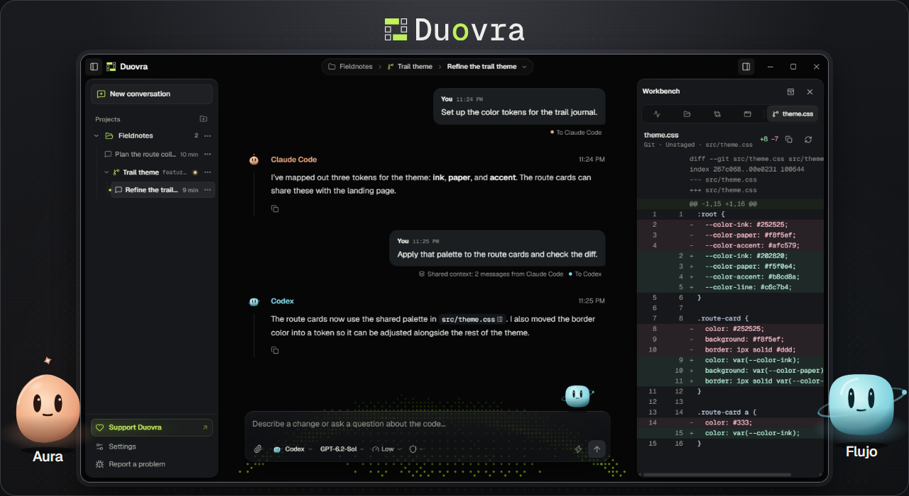
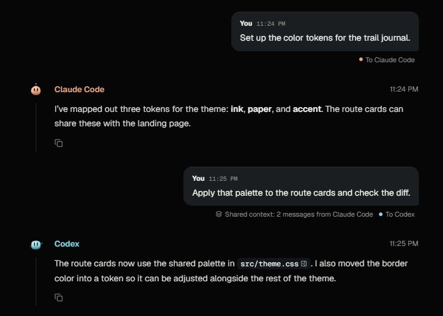
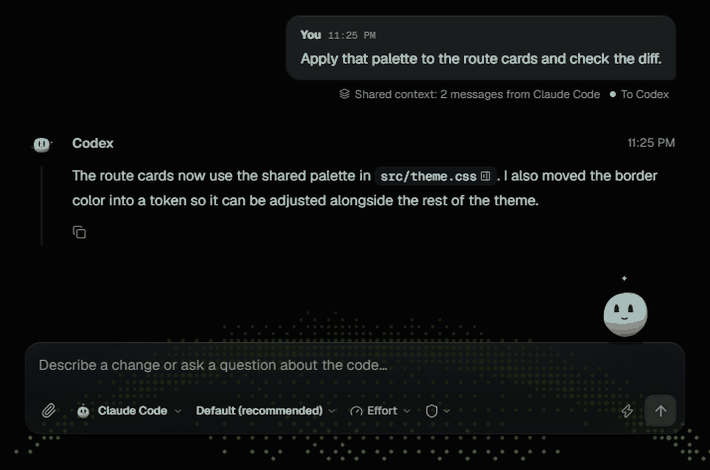
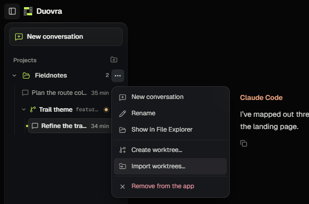
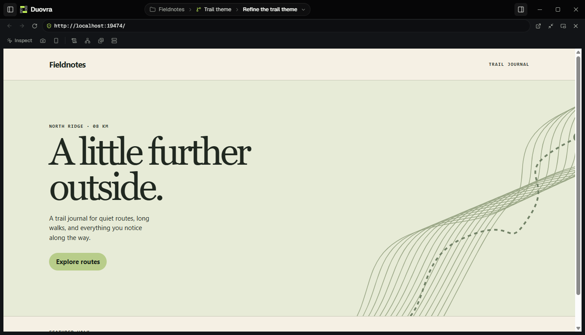
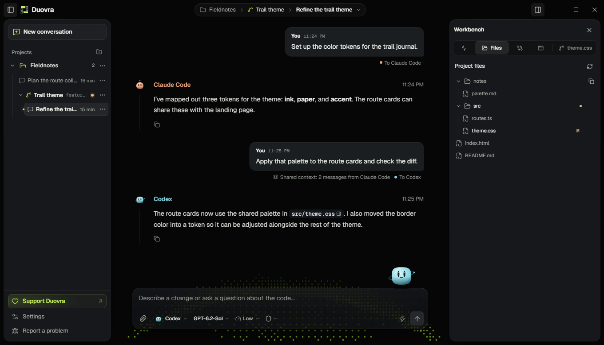

<h1 align="center">Duovra</h1>

  <strong>Claude Code and OpenAI Codex in one Windows workspace.</strong> 
  Open a project and choose who handles each message in the same conversation.

  <a href="https://github.com/yagues1/duovra/releases/latest"><strong>Download for Windows</strong></a> ·
  <a href="https://duovra.vercel.app/en">Official website</a> ·
  <a href="docs/README.es.md" lang="es">Español</a>

  
  
  
  

  

Duovra is a free, open-source desktop app for the official Claude Code and Codex CLIs. Choose the agent, model and reasoning effort in the composer. Duovra passes recent context when you switch agents and stores your projects, drafts and conversation history locally.

## Claude Code and Codex

Switch agents mid-conversation. Follow streamed responses and tool activity, review approvals inline, stop a run or queue the next message.

Watch Claude Code switch to Codex

[Open the agent-switch GIF](docs/screenshots/1.0.10/switch-agent.gif)

## Git Worktrees

Create or import Git worktrees and keep conversations, files, changes and previews tied to their branch folders.

## Live Preview

Open a local dev server in Workbench. Inspect elements, check console and network activity, simulate screen sizes or attach captures to your next prompt.

Watch the Live Preview inspector

[Open the inspector GIF](docs/screenshots/1.0.10/live-inspector.gif)

## Workbench

Browse project files, inspect Git changes and diffs, and open diagrams, static previews and supported widgets. Use conversation search, the command palette and file references to move around your workspace. Usage and provider limits appear when the CLIs report them.

## Personalization

Customize Graphite Glass with built-in patterns or a local image, adjust motion and switch between English and Spanish from Settings.

The images and demos show Duovra 1.0.10 with a sample project and conversation.

## Download and get started

Duovra runs on **Windows 11 x64** and needs [WebView2 Evergreen](https://developer.microsoft.com/en-us/microsoft-edge/webview2/).

1. Get the per-user installer or extract the full portable ZIP from the [latest release](https://github.com/yagues1/duovra/releases/latest).
2. Install and sign in to at least one official CLI. Use `claude auth login` for [Claude Code](https://code.claude.com/docs/en/setup) or `codex login` for [Codex](https://developers.openai.com/codex/cli). Install both to switch between them in the same conversation. Model access and billing follow your provider account.
3. Open **Settings → Agents and models** to confirm Duovra detects the CLIs. Choose **Add folder as project**, press `Ctrl+N`, and select an agent, model and reasoning effort in the composer.

Windows SmartScreen may appear because the installer and executable lack an Authenticode signature. For signed in-app updates, open **Settings → Updates and notifications**. If you are migrating from the beta, back up your profile first. [Windows distribution guide](docs/distribution.md)

## Privacy and permissions

Duovra keeps its workspace data locally in SQLite. The CLIs handle authentication and may send prompts, conversation context, attachments or project information to their providers during a turn. Review commands and file changes before approving them. [Local data and privacy](docs/distribution.md#reportes-y-privacidad) · [Report a security issue](SECURITY.md)

## Support Duovra

Duovra is free and open source. Everyone gets the same features. You can help by reporting an issue, starring the repository or contributing through the links below. Payments are handled by those platforms. [Official support page](https://duovra.vercel.app/en#support)

  
  

## Build and contribute

Duovra uses Tauri 2, React, TypeScript, Rust and SQLite. [Build from source](CONTRIBUTING.md#set-up-the-environment) · [Architecture](docs/architecture.md) · [Agent integration](docs/agent-integration.md) · [Contributing](CONTRIBUTING.md) · [Changelog](CHANGELOG.md)

## License

[MIT](LICENSE). Third-party components retain their own terms. See the [third-party notices](THIRD_PARTY_NOTICES.md).
