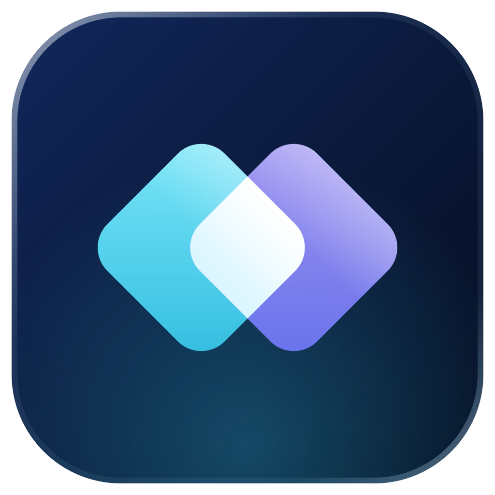
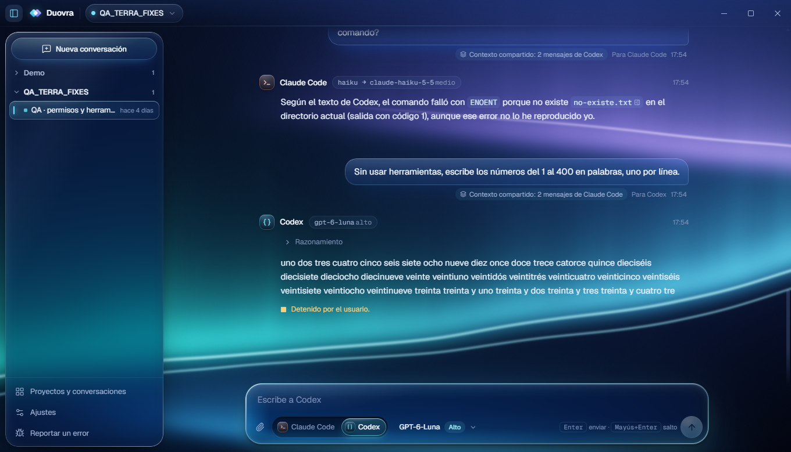
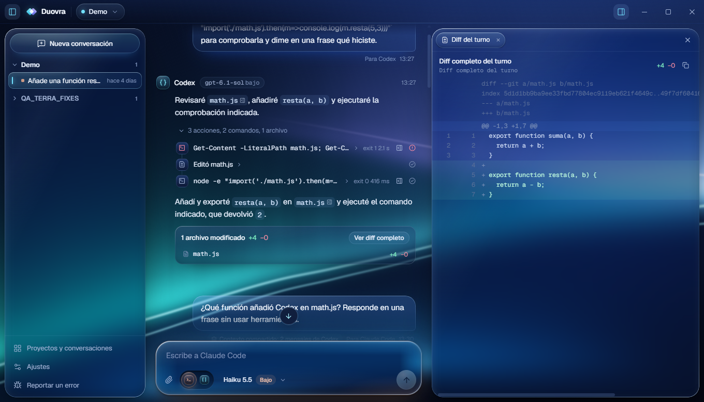
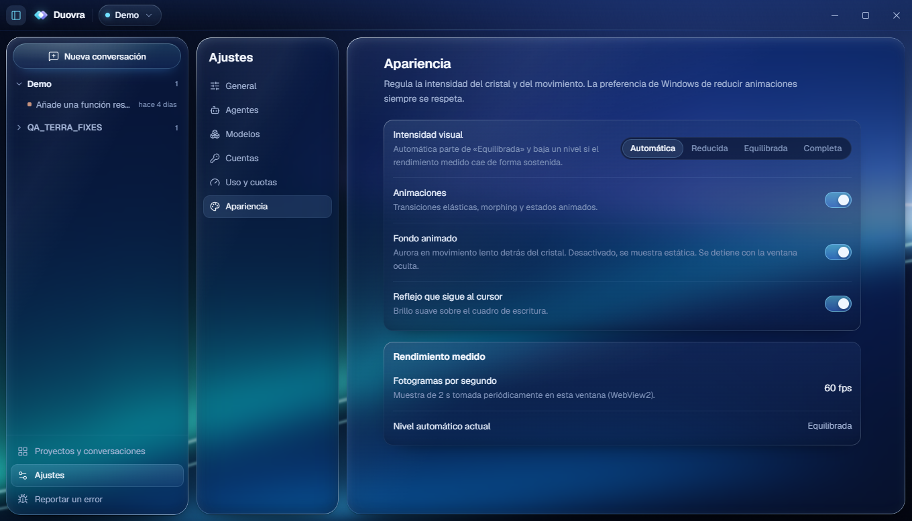

<div align="center">



# Duovra

**One workspace. Your coding agents.**

An open-source desktop workspace for Claude Code and OpenAI Codex.

[](https://github.com/yagues1/duovra/actions/workflows/ci.yml)
[](LICENSE)


[Features](#features) · [How it works](#how-it-works) · [Installation](#installation) · [Quick start](#quick-start) · [Development](#development) · [Roadmap](#roadmap) · [Español](docs/README.es.md)

<br>



</div>

---

Duovra puts the coding agents you already use, **Claude Code** and **OpenAI Codex**, in one native Windows app. Choose the agent, model and reasoning level for every message. Both agents share the same conversation history, and your projects, conversations and drafts stay on your machine.

It doesn't replace either tool. Duovra drives the official CLIs installed on your computer, with your own sign-in and configuration.

## Features

| | |
|---|---|
| **Two agents, one conversation** | Switch between Claude Code and Codex message by message. The other agent receives the conversation history, so it can continue the same thread. |
| **Per-message model and reasoning** | Pick from the models each CLI reports for your account, plus the reasoning levels it supports. Each conversation remembers its last choice. |
| **Local projects** | Open any folder as a project. Each project keeps its own conversations, with drafts restored when you come back. |
| **Live streaming and cancellation** | Responses, reasoning, commands and file edits stream in as a collapsible timeline. Stop a run at any moment and keep typing while the agent works. |
| **Permissions in the conversation** | Tool approvals appear inline: allow once, allow for the session, or deny. The sandbox and approval policies of each CLI are configurable. |
| **Files, diffs and terminal output** | A contextual side panel shows touched files, syntax-highlighted diffs and command output without leaving the chat. |
| **Persistent local history** | Conversations, settings and usage records are stored in SQLite on your computer. Nothing is sent to Duovra servers, because there aren't any. |
| **Liquid Glass interface** | One material system across the app: refractive composer, glass panels, specular rims and fluid spring animations. Visual intensity adapts to your hardware. |
| **Dynamic aurora background** | A lightweight WebGL aurora moves slowly behind the glass. It pauses when the window is hidden and stays still with reduced motion. |
| **Usage at a glance** | Codex rate-limit windows as reported by Codex, plus the token counts each agent reports for every message. |

<details>
<summary><b>Current status of updates and bug reports</b></summary>

- **Updates.** Releases are signed with the permanent Duovra key and published on GitHub Releases. From 0.3.0 onwards the app checks the signed channel and installs updates with the Windows installer's basic interface. Versions before 0.3.0 must be updated manually once.
- **Bug reports.** **Report a bug** sends the report directly from the app over HTTPS to the Duovra report service ([`services/bug-reports`](services/bug-reports), a Cloudflare Worker), which files it in a private intake repository. No GitHub account or browser is needed, and nothing is sent without your explicit consent: no conversations, code, paths or logs.

</details>

## Screenshots

<table>
  <tr>
    <td width="50%"></td>
    <td width="50%"></td>
  </tr>
  <tr>
    <td align="center"><sub>Contextual panel with files, diffs and terminal output</sub></td>
    <td align="center"><sub>Settings for agents, models, accounts, usage and appearance</sub></td>
  </tr>
</table>

## How it works

```
┌──────────────────────── Duovra (Tauri 2) ────────────────────────┐
│  React + TypeScript UI  ──IPC──▶  Rust backend  ──▶  SQLite       │
│                                      │                            │
│                       ┌──────────────┴──────────────┐             │
│                       ▼                             ▼             │
│         claude  (stream-json, stdio)    codex app-server (JSON-RPC) │
└───────────────────────────────────────────────────────────────────┘
```

- Duovra launches the **official CLIs** (`claude` and `codex`) as child processes, using the installation, sign-in and configuration already on your computer. It never reads or stores your tokens.
- **You** pick the agent for each message. Duovra doesn't route, chain or orchestrate agents automatically.
- When you switch agents, Duovra passes the recent conversation to the next agent as context. Each provider also keeps its own session, so it can resume where it left off.
- Model access, limits and billing are those of your own Anthropic or OpenAI plan. Duovra doesn't provide model access.

More detail: [Architecture](docs/architecture.md) · [Agent integration](docs/agent-integration.md).

## Installation

**Requirements**

- Windows 11 x64 (developed and tested there). Windows 10 with the Microsoft Edge WebView2 Runtime should work but hasn't been tested yet.
- At least one agent CLI, installed and signed in:
  - [Claude Code](https://docs.claude.com/en/docs/claude-code/overview): `claude` on your `PATH`, then sign in with `claude` or `claude auth login`.
  - [OpenAI Codex CLI](https://developers.openai.com/codex/cli): `codex` on your `PATH`, then sign in with `codex login`.

**Install**

A public installer is **not published yet**. The first signed release will be on the [Releases](https://github.com/yagues1/duovra/releases) page. Until then, [build it from source](#development). It takes a few minutes with Node.js and Rust installed.

> [!NOTE]
> Windows SmartScreen may warn about installers without an Authenticode certificate. Only install builds from this repository's Releases page.

## Quick start

1. **Install Duovra** (see above) and make sure `claude` and/or `codex` work in a terminal.
2. Open **Settings → Agents** to check that Duovra detected each CLI. You can also set a custom executable path there.
3. **Add a project:** click the project capsule in the title bar and choose a local folder.
4. **Start a conversation** with **New conversation** or `Ctrl+N`.
5. In the composer, **choose Claude Code or Codex**, a model and a reasoning level, then press `Enter`.

Shortcuts: `Ctrl+N` new conversation · `Ctrl+B` toggle sidebar · `Ctrl+,` settings · `Shift+Enter` new line · `Esc` close panel.

## Technology

| Layer | Stack |
|---|---|
| Shell | [Tauri 2](https://tauri.app) on WebView2 |
| UI | [React 19](https://react.dev), TypeScript, [Tailwind CSS 4](https://tailwindcss.com), [Motion](https://motion.dev), [Zustand](https://zustand.docs.pmnd.rs) |
| Materials | CSS glass system, [Vaso](https://github.com/huozhi/vaso) refraction lens and a WebGL aurora shader |
| Backend | Rust, Tokio, [rusqlite](https://github.com/rusqlite/rusqlite) (bundled SQLite) |

## Development

**Prerequisites:** Node.js 22.12+, Rust stable (MSVC toolchain recommended), Visual Studio C++ build tools, and Windows 11.

```powershell
git clone https://github.com/yagues1/duovra.git
cd duovra
npm ci

npm run tauri dev     # run the app with hot reload
npm run tauri build   # release executable + NSIS installer
```

Build output:

- Executable: `src-tauri\target\release\duovra.exe`
- Installer: `src-tauri\target\release\bundle\nsis\Duovra_<version>_x64-setup.exe`

**Tests**

```powershell
npm run typecheck
npm test                                                  # Vitest (frontend logic)
cargo test --manifest-path src-tauri/Cargo.toml --lib     # Rust backend
```

`npm run dev` serves the UI in a browser with a mocked backend (`src/dev/mockTauri.ts`), which is useful for UI work without the agents.

**Project layout**

```
src/                 React UI (components, state, styles, materials)
src/lib/aurora.ts    WebGL aurora background
src-tauri/src/       Rust backend: commands, SQLite, agent adapters (agents/claude.rs, agents/codex.rs)
services/            Optional bug-report relay (Cloudflare Worker)
docs/                Architecture, agent integration, design system
assets/brand/        Duovra logo and icon sources (generated by scripts/brand.mjs)
```

## Contributing

Contributions are welcome: bug reports, fixes, documentation and focused UI improvements. Please read [CONTRIBUTING.md](CONTRIBUTING.md) and the [Code of Conduct](CODE_OF_CONDUCT.md) first. Report security issues privately as described in [SECURITY.md](SECURITY.md).

## Roadmap

These are goals, not promises:

- [ ] First signed public release with an active update channel
- [ ] English UI (the interface is currently in Spanish) and localization support
- [ ] macOS and Linux builds (Tauri supports them; the agent adapters need testing there)
- [ ] Search across conversations
- [ ] Richer diff review (accept or reject individual hunks)

## License

Duovra is released under the [MIT License](LICENSE). Third-party components keep their own licenses. See [THIRD_PARTY_NOTICES.md](THIRD_PARTY_NOTICES.md).

## Disclaimer

Duovra is an independent open-source project. It isn't affiliated with, endorsed by or sponsored by Anthropic or OpenAI. *Claude* and *Claude Code* are trademarks of Anthropic, PBC. *OpenAI* and *Codex* are trademarks of OpenAI. They're used here only to identify the tools Duovra works with. Duovra doesn't include either company's logos.
