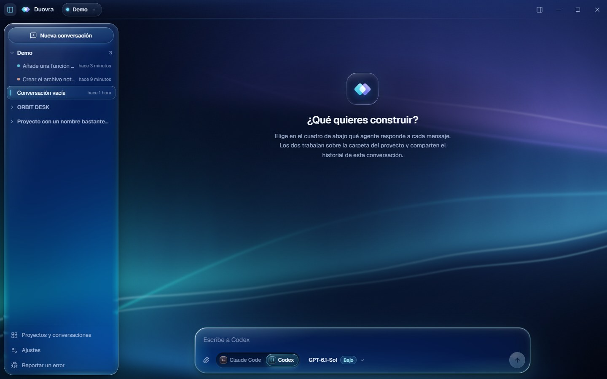
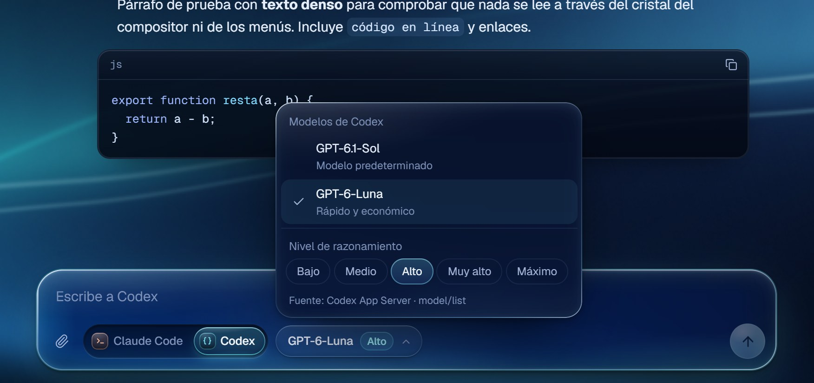
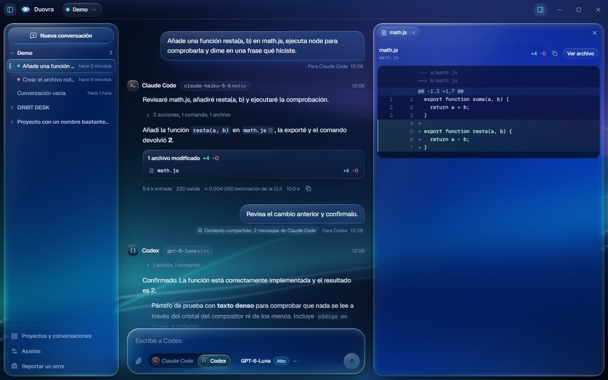
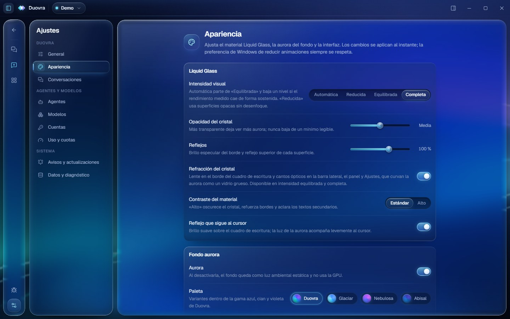

<div align="center">


# Duovra

**One workspace. Your coding agents.**

An open-source desktop workspace for **Claude Code** and **OpenAI Codex**:<br>
one shared conversation, local projects, and you choose the agent for every message.

[](https://github.com/yagues1/duovra/actions/workflows/ci.yml)
[](https://github.com/yagues1/duovra/releases/latest)
[](LICENSE)


[**Download**](https://github.com/yagues1/duovra/releases/latest) · [Features](#features) · [Screenshots](#screenshots) · [Installation](#installation) · [Documentation](#documentation) · [Contributing](#contributing) · [Español](docs/README.es.md)

<br>


<sub><b>Duovra 0.4.0 — Visual Experience</b> (in development). The current downloadable release is <a href="https://github.com/yagues1/duovra/releases/latest">0.3.1</a>; its screenshots are in <a href="docs/screenshots/0.3.1">docs/screenshots/0.3.1</a>.</sub>

</div>

---

## Why Duovra

Claude Code and Codex each have their own strengths. Duovra puts them side by side in one native Windows app, so you can **ask Claude Code to build something and Codex to review it, in the same thread**. Both agents see the shared history; your projects, conversations and drafts never leave your machine.

Duovra doesn't replace either tool and doesn't route or chain agents automatically. It drives the **official CLIs already installed on your computer**, with your own sign-in, plan and configuration.

## Features

| | |
|---|---|
| **Two agents, one conversation** | Switch between Claude Code and Codex message by message. The other agent receives the recent history, so it continues the same thread. |
| **Per-message model and reasoning** | Pick from the models each CLI reports for your account and the reasoning levels it supports. Each conversation remembers its choice per agent. |
| **Local projects** | Any folder can be a project, with its own conversations and restored drafts. |
| **Live timeline and cancellation** | Responses, reasoning, commands and file edits stream into a collapsible timeline. Stop a run at any moment and keep typing meanwhile. |
| **Permissions in the conversation** | Tool approvals appear inline: allow once, for the session, or deny. Sandbox and approval policies are configurable per CLI. |
| **Files, diffs and terminal output** | A contextual side panel, opened on demand, shows touched files, syntax-highlighted diffs and command output. |
| **Persistent local history** | Conversations, settings and usage records live in SQLite on your computer. There are no Duovra servers for your data. |
| **Usage at a glance** | Codex rate-limit windows as Codex reports them, plus the token counts each agent reports per message. |
| **Signed updates** | Releases are signed and published on GitHub Releases; the app checks the signed channel and installs with the Windows installer. |
| **In-app bug reports** | Report a bug from the sidebar with an explicit preview of what will be sent. No conversations, code or paths are included. |

### The visual experience

Duovra is built to be comfortable for hours of work and pleasant to look at:

- **Liquid Glass 2.0.** One material system in three levels: premium glass for the sidebar, composer, panel and dialogs; interactive glass for buttons, pills and selectors; reading glass for messages, code and diffs.
- **Real refraction.** The composer bends the background through a [Vaso](https://github.com/huozhi/vaso) lens, and the edges of the sidebar, panel and settings act as thick glass: the aurora visibly curves behind them.
- **Dynamic aurora.** A lightweight WebGL aurora with several depth layers, silk-like light sheets and a calm reading zone behind the conversation. Glass rims and caustics take their tint from the light behind each surface, and the light follows the cursor very slightly.
- **Fluid motion.** Interruptible spring animations for agent switching, selection pills, menus, panels and settings, with no scaled text and no layout jumps.
- **Yours to tune.** Visual intensity (automatic, reduced, balanced, full), glass opacity, reflections, refraction, high contrast, aurora palette, brightness and speed, density, text and code size. Windows' reduced-motion and transparency preferences are always respected.

## Screenshots

> [!NOTE]
> These screenshots show **Duovra 0.4.0, which is still in development** and not yet released. They are real captures of the app's interface with fictitious demo data (mocked backend, rendered with the same Chromium engine as WebView2), so no real conversations or accounts appear. The current release, [0.3.1](https://github.com/yagues1/duovra/releases/latest), looks like [these screenshots](docs/screenshots/0.3.1).

<table>
  <tr>
    <td width="50%"></td>
    <td width="50%"></td>
  </tr>
  <tr>
    <td align="center"><sub><b>Aurora Glass.</b> A new conversation, calm in the centre.</sub></td>
    <td align="center"><sub><b>Composer.</b> Agent, model and reasoning per message.</sub></td>
  </tr>
  <tr>
    <td width="50%"></td>
    <td width="50%"></td>
  </tr>
  <tr>
    <td align="center"><sub><b>Contextual panel.</b> Files, diffs and terminal output.</sub></td>
    <td align="center"><sub><b>Appearance.</b> Glass, aurora and interface preferences.</sub></td>
  </tr>
</table>

<p align="center">
  <br>
  <sub><b>In motion.</b> The aurora behind the glass while switching agents (7 s, reduced frame rate).</sub>
</p>

## Installation

**Download:** get the latest Windows installer (`Duovra_<version>_x64-setup.exe`) from **[Releases](https://github.com/yagues1/duovra/releases)**. Installed versions from 0.3.0 onwards update themselves from the signed channel.

**Requirements**

- Windows 11 x64 (developed and tested there). Windows 10 with the Microsoft Edge WebView2 Runtime should work but hasn't been tested.
- At least one agent CLI, installed and signed in with your own account:
  - [Claude Code](https://docs.claude.com/en/docs/claude-code/overview): `claude` on your `PATH`, then sign in with `claude` or `claude auth login`.
  - [OpenAI Codex CLI](https://developers.openai.com/codex/cli): `codex` on your `PATH`, then sign in with `codex login`.
- Model access, limits and billing are those of your own Anthropic or OpenAI plan. Duovra doesn't provide model access.

> [!NOTE]
> The installer isn't signed with an Authenticode certificate yet, so Windows SmartScreen may show a warning. Only install builds from this repository's Releases page.

## Quick start

1. Install Duovra and check that `claude` and/or `codex` work in a terminal.
2. Open **Settings → Agents** to confirm Duovra detected each CLI (you can set a custom path there).
3. **Add a project** from the project capsule in the title bar.
4. Start a conversation with **New conversation** or `Ctrl+N`.
5. In the composer, choose **Claude Code** or **Codex**, a model and a reasoning level, and send.

Shortcuts: `Ctrl+N` new conversation · `Ctrl+B` toggle sidebar · `Ctrl+,` settings · `Esc` close panel.

## How it works

```
┌──────────────────────── Duovra (Tauri 2) ────────────────────────┐
│  React + TypeScript UI  ──IPC──▶  Rust backend  ──▶  SQLite       │
│                                      │                            │
│                       ┌──────────────┴──────────────┐             │
│                       ▼                             ▼             │
│         claude  (stream-json, stdio)    codex app-server (JSON-RPC) │
└───────────────────────────────────────────────────────────────────┘
```

- Duovra launches the official CLIs as child processes. It never reads or stores your tokens.
- **You** pick the agent for each message; nothing is orchestrated automatically.
- When you switch agents, the recent conversation is passed as context. Each provider also keeps its own session and resumes where it left off.

| Layer | Stack |
|---|---|
| Shell | [Tauri 2](https://tauri.app) on WebView2 |
| UI | [React 19](https://react.dev), TypeScript, [Tailwind CSS 4](https://tailwindcss.com), [Motion](https://motion.dev), [Zustand](https://zustand.docs.pmnd.rs) |
| Materials | CSS glass system, [Vaso](https://github.com/huozhi/vaso) refraction lens, WebGL aurora shader with optical edges |
| Backend | Rust, Tokio, [rusqlite](https://github.com/rusqlite/rusqlite) (bundled SQLite) |

## Development

**Prerequisites:** Node.js 22.12+, Rust stable (MSVC toolchain recommended), Visual Studio C++ build tools, Windows 11.

```powershell
git clone https://github.com/yagues1/duovra.git
cd duovra
npm ci
npm run tauri dev     # run the app with hot reload
npm run tauri build   # release executable + NSIS installer
```

```powershell
npm run typecheck
npm test                                                  # Vitest (frontend logic)
cargo test --manifest-path src-tauri/Cargo.toml --lib     # Rust backend
```

`npm run dev` serves the UI in a browser with a mocked backend (`src/dev/mockTauri.ts`) for UI work without the agents. `node scripts/qa/visual-scenes.mjs` captures the same demo scenes in Microsoft Edge for visual comparisons.

```
src/                 React UI (components, state, styles, materials)
src/lib/aurora.ts    WebGL aurora background and optical edges
src/lib/optics.ts    Lenses and ambient light shared by the aurora and the glass
src-tauri/src/       Rust backend: commands, SQLite, agent adapters
services/            Bug-report relay (Cloudflare Worker)
docs/                Architecture, agent integration, design system
assets/brand/        Logo and icon sources (generated by scripts/brand.mjs)
```

## Documentation

- [Architecture](docs/architecture.md) · [Agent integration](docs/agent-integration.md)
- [Design system and materials](docs/design-system.md) · [Design references](docs/design-references.md)
- [Distribution, updates and bug reports](docs/distribution.md) · [Compatibility](docs/compatibility.md)
- [Changelog](CHANGELOG.md) · [Third-party notices](THIRD_PARTY_NOTICES.md)

Technical documentation is written in Spanish; this README and the changelog are in English.

## Roadmap

Goals, not promises:

- [x] Signed public release with an active update channel (0.3.x)
- [x] In-app bug reports (0.3.x)
- [x] Liquid Glass 2.0 and Aurora 2.0 (0.4.0, in review)
- [ ] English UI (the interface is currently in Spanish) and localization support
- [ ] Authenticode-signed installer
- [ ] macOS and Linux builds (Tauri supports them; the agent adapters need testing there)
- [ ] Search across conversations
- [ ] Richer diff review (accept or reject individual hunks)

## Contributing

Contributions are welcome: bug reports, fixes, documentation and focused UI improvements. Please read [CONTRIBUTING.md](CONTRIBUTING.md) and the [Code of Conduct](CODE_OF_CONDUCT.md) first. Report security issues privately as described in [SECURITY.md](SECURITY.md).

## License

Duovra is released under the [MIT License](LICENSE). Third-party components keep their own licenses; see [THIRD_PARTY_NOTICES.md](THIRD_PARTY_NOTICES.md).

## Disclaimer

Duovra is an independent open-source project. It isn't affiliated with, endorsed by or sponsored by Anthropic or OpenAI. *Claude* and *Claude Code* are trademarks of Anthropic, PBC. *OpenAI* and *Codex* are trademarks of OpenAI. They're used only to identify the tools Duovra works with. Duovra doesn't include either company's logos.
