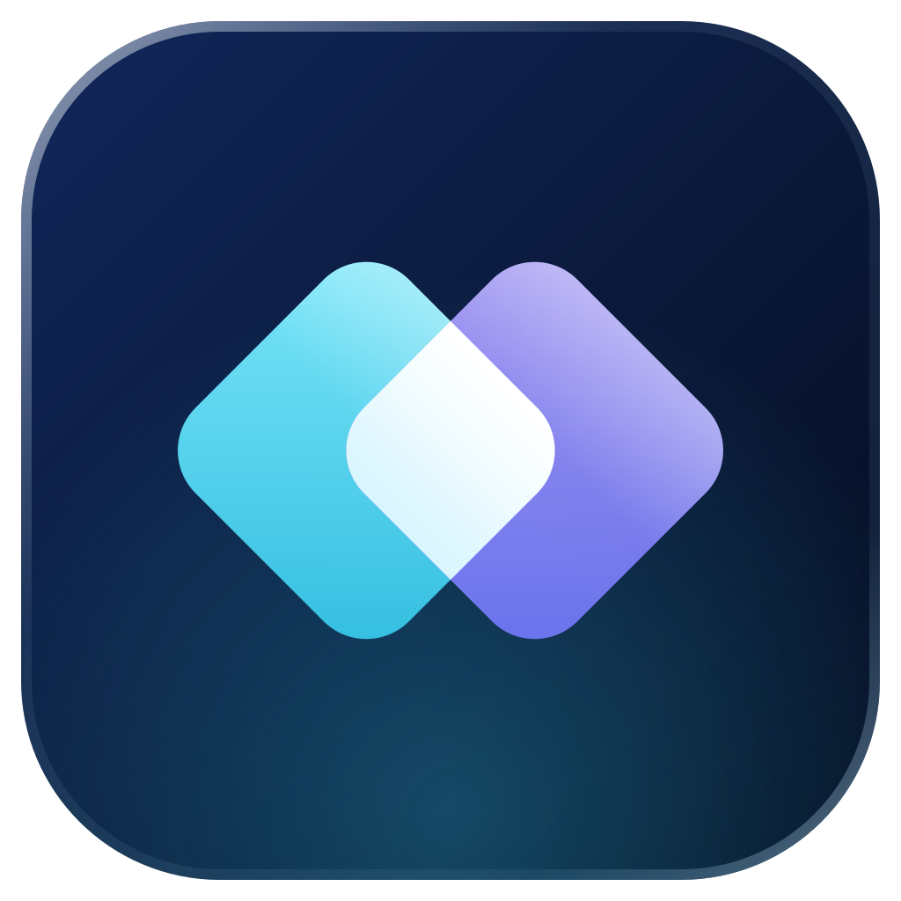
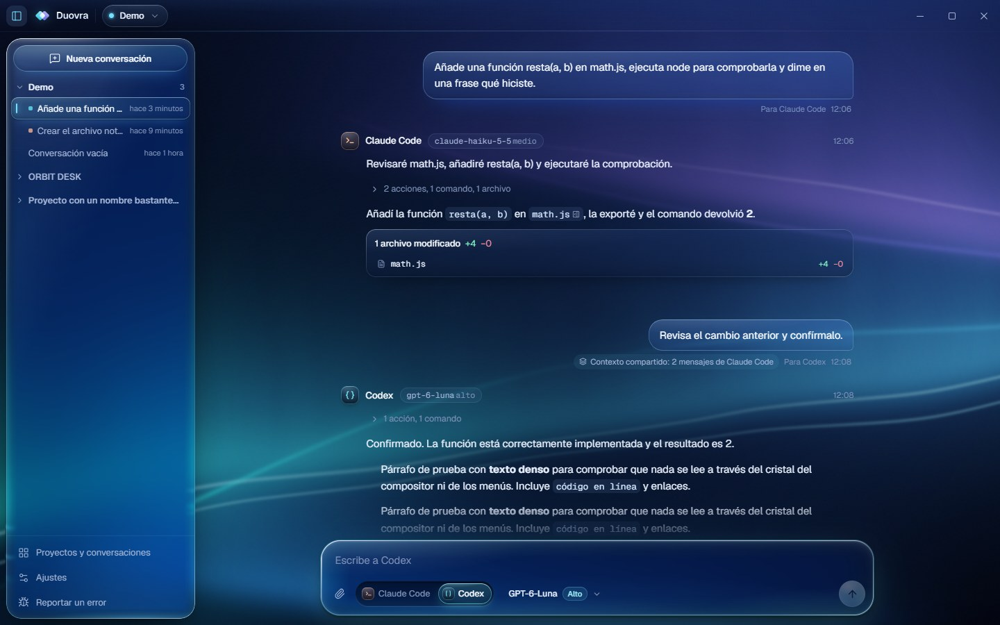

# Duovra

**Un espacio de trabajo. Tus agentes de programación.**

Aplicación de escritorio open source para **Claude Code** y **OpenAI Codex**: una conversación compartida, proyectos locales y el agente que tú eliges en cada mensaje.

[**Descargar**](https://github.com/yagues1/duovra/releases/latest) · [English](../README.md)

 

<b>Duovra 0.4.0 — Visual Experience.</b> <a href="https://github.com/yagues1/duovra/releases/latest">Descargar la última versión</a> · <a href="../CHANGELOG.md">Novedades</a>

Duovra reúne en una aplicación nativa de Windows los agentes de programación que ya usas: **Claude Code** y **Codex**. En cada mensaje eliges el agente, el modelo y el nivel de razonamiento. Ambos agentes comparten el historial de la conversación, y tus proyectos, conversaciones y borradores se quedan en tu equipo.

Duovra no sustituye a ninguna de las dos herramientas: utiliza las CLIs oficiales instaladas en tu equipo, con tu propio inicio de sesión y tu configuración. No incluye acceso a modelos ni orquesta los agentes automáticamente. El agente lo eliges tú.

## Funciones

- Claude Code y Codex en la misma conversación, con cambio manual de agente en cada mensaje.
- Modelo y razonamiento por mensaje, según el catálogo que informa cada CLI para tu cuenta.
- Proyectos locales con sus conversaciones y borradores.
- Streaming de respuestas, comandos y ediciones, y cancelación en cualquier momento.
- Permisos de herramientas en la propia conversación: permitir una vez, durante la sesión o rechazar.
- Panel contextual bajo demanda con archivos, diffs y salida de terminal.
- Historial persistente en SQLite local.
- **Actualizaciones firmadas:** desde la 0.3.0, la aplicación consulta el canal firmado de GitHub Releases e instala con el instalador de Windows.
- **Reportes de error integrados:** se envían desde la aplicación, con vista previa de lo que se envía y sin conversaciones, código ni rutas.

### Experiencia visual

- **Liquid Glass 2.0:** cristal premium (barra lateral, compositor, panel, diálogos), interactivo (botones, cápsulas, selectores) y de lectura (mensajes, código, diffs).
- **Refracción real:** lente en el compositor y cantos ópticos en la barra lateral, el panel y Ajustes, donde la aurora se curva como detrás de un vidrio grueso.
- **Aurora dinámica 2.0:** capas con profundidad, láminas de luz y una zona de lectura tranquila detrás de la conversación. Los reflejos del cristal toman el tono de la luz que tienen detrás.
- **Animaciones con muelles** interrumpibles, sin escalar texto.
- **Personalización:** intensidad visual (automática, reducida, equilibrada, completa), opacidad, reflejos, refracción, contraste alto, paleta, brillo y velocidad de la aurora, densidad y tamaño de texto y código. Se respetan las preferencias de Windows de reducir movimiento y transparencia.

## Instalación

Descarga el instalador de Windows (`Duovra_<versión>_x64-setup.exe`) desde [Releases](https://github.com/yagues1/duovra/releases). Las versiones instaladas desde la 0.3.0 se actualizan desde el canal firmado.

Requisitos:

- Windows 11 x64 con WebView2 (Windows 10 debería funcionar, pero no se ha probado).
- Al menos una CLI instalada y con tu sesión iniciada: [Claude Code](https://docs.claude.com/en/docs/claude-code/overview) (`claude`) o [Codex CLI](https://developers.openai.com/codex/cli) (`codex`).
- El acceso a los modelos, los límites y la facturación son los de tu propio plan de Anthropic u OpenAI. Duovra no proporciona acceso a modelos.

El instalador todavía no tiene firma Authenticode, así que SmartScreen puede mostrar un aviso. Instala solo las compilaciones de la página de Releases de este repositorio.

## Primeros pasos

1. Instala Duovra y comprueba que `claude` o `codex` funcionan en una terminal.
2. En **Ajustes → Agentes**, verifica que se detectan las CLIs.
3. Añade un proyecto desde la cápsula de proyecto de la barra superior.
4. Crea una conversación (`Ctrl+N`).
5. Elige **Claude Code** o **Codex**, el modelo y el razonamiento, y escribe.

## Documentación técnica (en español)

- [Arquitectura](architecture.md) · [Integración con los agentes](agent-integration.md) · [Visión general](project-overview.md)
- [Sistema de diseño y materiales](design-system.md) · [Tecnología visual](visual-technology.md) · [Compatibilidad](compatibility.md)
- [Distribución, firma y reportes](distribution.md) · [Política de modelos para pruebas](qa/test-model-policy.md)
- [Historial de cambios](../CHANGELOG.md) (en inglés)

## Licencia y marcas

Licencia [MIT](../LICENSE). Duovra es un proyecto independiente: no está afiliado a Anthropic ni a OpenAI, y ninguna de las dos empresas lo respalda. Claude y Claude Code son marcas de Anthropic, PBC. OpenAI y Codex son marcas de OpenAI. Consulta [THIRD_PARTY_NOTICES.md](../THIRD_PARTY_NOTICES.md).
