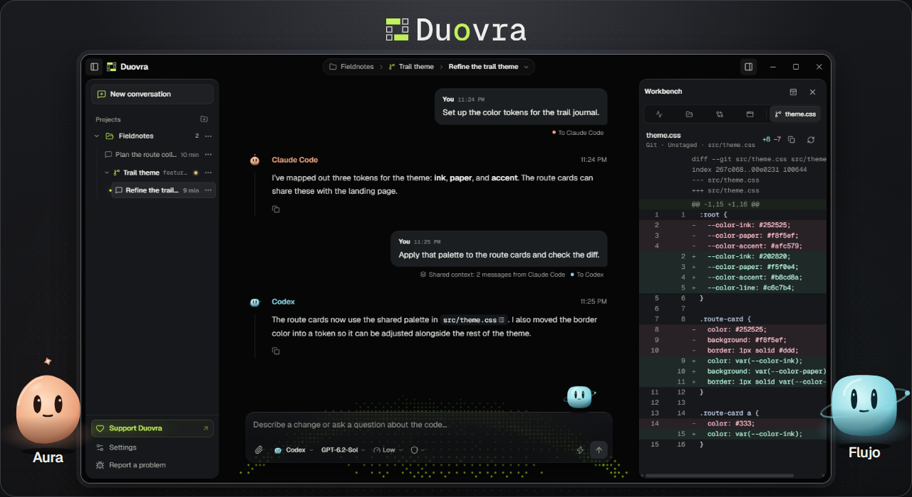
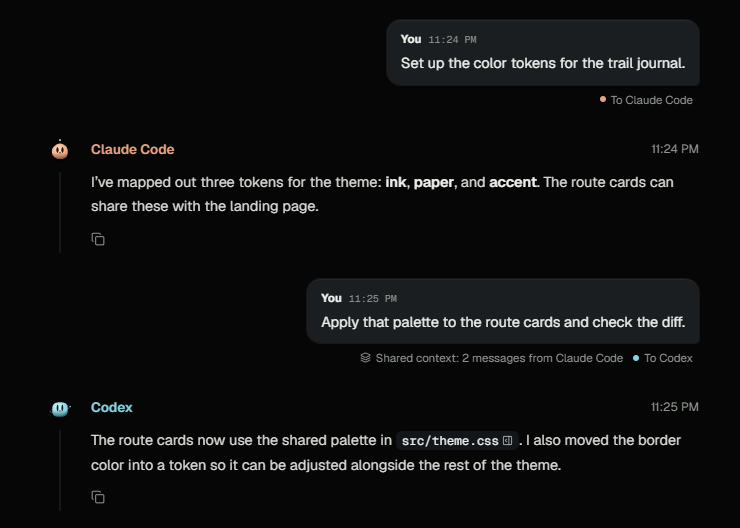
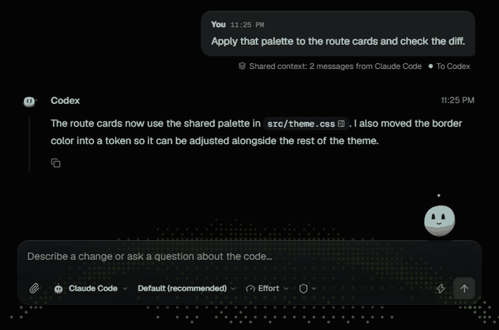
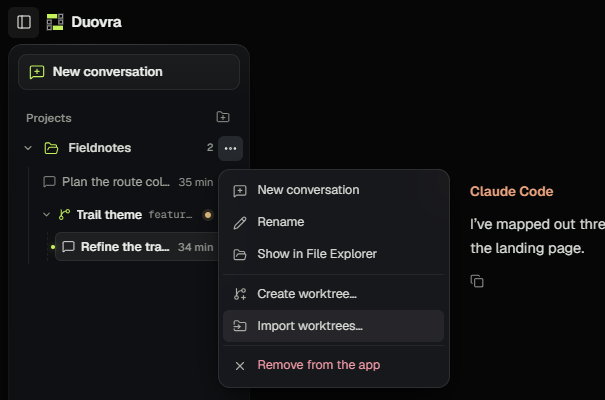
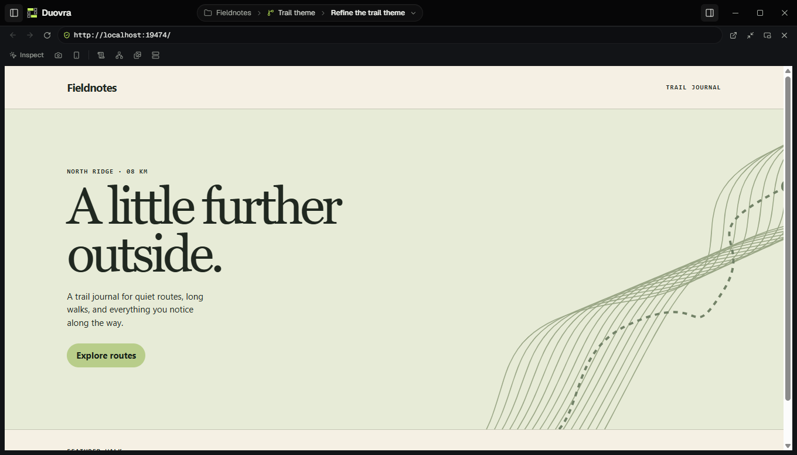
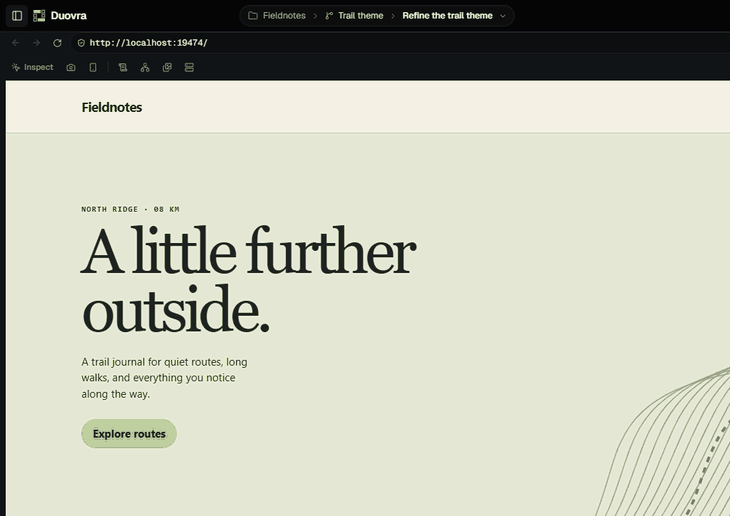
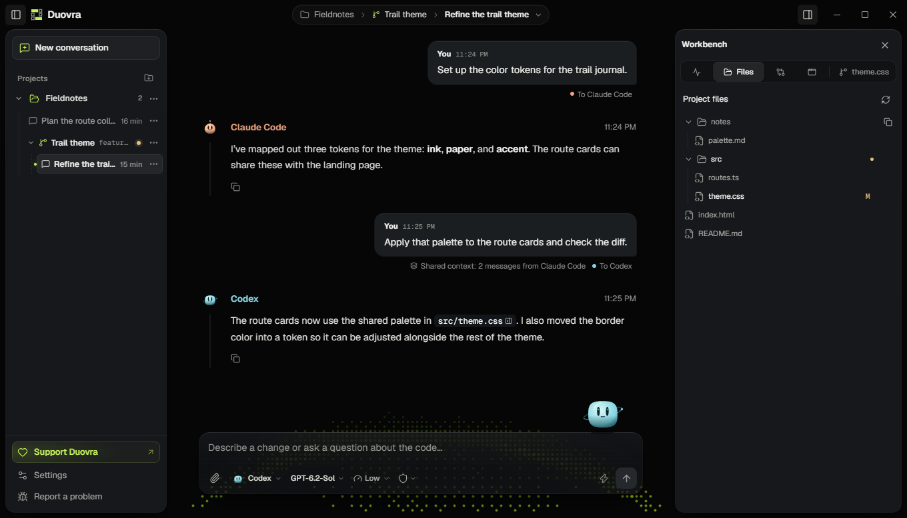
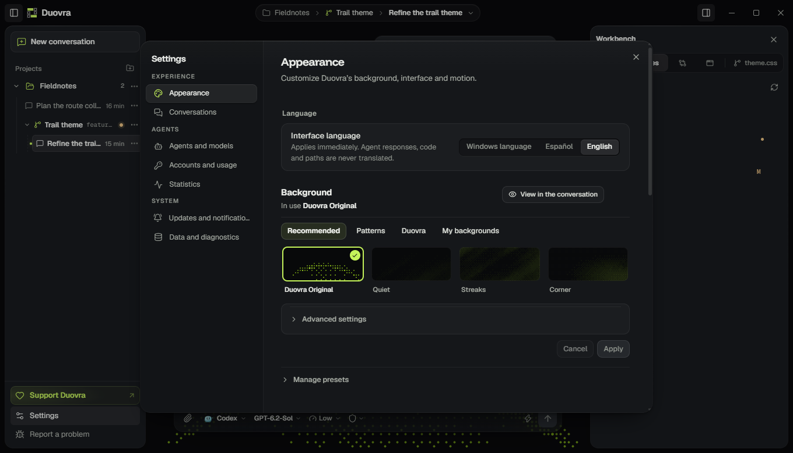

<h1 align="center">Duovra</h1>

  <strong>Claude Code y OpenAI Codex en un mismo espacio de trabajo para Windows.</strong> 
  Abre un proyecto y elige quién responde a cada mensaje en la misma conversación.

  <a href="https://github.com/yagues1/duovra/releases/latest"><strong>Descargar para Windows</strong></a> ·
  <a href="https://duovra.vercel.app/">Web oficial</a> ·
  <a href="../README.md" lang="en">English</a>

  
  
  
  

  

Duovra es una aplicación de escritorio gratuita y de código abierto para las CLI oficiales de Claude Code y Codex. Elige agente, modelo y esfuerzo en el compositor. Duovra pasa el contexto reciente cuando cambias de agente y guarda tus proyectos, borradores e historial de conversaciones en tu equipo.

## Claude Code y Codex

Cambia de agente en mitad de una conversación. Sigue las respuestas y la actividad de herramientas en directo, revisa las solicitudes de aprobación, detén una ejecución o pon el próximo mensaje en cola.

Ver el cambio de Claude Code a Codex

[Abrir el GIF del cambio de agente](screenshots/1.0.10/switch-agent.gif)

## Git Worktrees

Crea o importa worktrees de Git y vincula las conversaciones, los archivos, los cambios y las vistas previas a la carpeta de cada rama.

## Live Preview

Abre un servidor de desarrollo local dentro de Workbench. Inspecciona elementos, consulta la consola y la actividad de red, simula tamaños de pantalla o adjunta capturas al siguiente mensaje.

Ver el inspector de Live Preview

[Abrir el GIF del inspector](screenshots/1.0.10/live-inspector.gif)

## Workbench

Explora archivos, revisa cambios y diffs de Git, y abre diagramas, vistas estáticas y widgets compatibles. Usa la búsqueda de conversaciones, la paleta de comandos y las referencias a archivos para moverte por tu espacio. Duovra muestra el uso y los límites cuando las CLI los proporcionan.

## Personalización

Personaliza Graphite Glass con patrones incluidos o una imagen local, ajusta el movimiento y cambia entre inglés y español desde Ajustes.

Las imágenes y demos muestran Duovra 1.0.10 con un proyecto y una conversación de ejemplo.

## Descargar y empezar

Duovra funciona en **Windows 11 x64** y requiere [WebView2 Evergreen](https://developer.microsoft.com/en-us/microsoft-edge/webview2/).

1. Descarga el instalador por usuario o extrae el ZIP portátil completo desde la [última versión](https://github.com/yagues1/duovra/releases/latest).
2. Instala al menos una de las CLI oficiales e inicia sesión. Usa `claude auth login` para [Claude Code](https://code.claude.com/docs/en/setup) o `codex login` para [Codex](https://developers.openai.com/codex/cli). Instala ambas para alternarlas durante una conversación. El acceso a modelos y la facturación dependen de tu cuenta con cada proveedor.
3. Abre **Ajustes → Agentes y modelos** para comprobar que Duovra detecta las CLI. Elige **Añadir carpeta como proyecto**, pulsa `Ctrl+N` y selecciona agente, modelo y esfuerzo en el compositor.

Windows SmartScreen puede aparecer porque el ejecutable y el instalador carecen de firma Authenticode. Para buscar actualizaciones firmadas desde la app, abre **Ajustes → Actualizaciones y avisos**. Si vienes de la beta, haz primero una copia de tu perfil. [Guía de distribución para Windows](distribution.md)

## Privacidad y permisos

Duovra guarda los datos del espacio de trabajo en SQLite, en tu equipo. Las CLI se encargan de la autenticación y pueden enviar al proveedor el mensaje, contexto de la conversación, adjuntos o información del proyecto durante un turno. Revisa los comandos y cambios de archivos antes de aprobarlos. [Datos locales y privacidad](distribution.md#reportes-y-privacidad) · [Reportar un problema de seguridad](../SECURITY.md)

## Apoyar Duovra

Duovra es gratuito y de código abierto. Todas las funciones están disponibles para todo el mundo. Puedes ayudar abriendo un issue, dando una estrella al repositorio o aportando en una de estas plataformas, donde se gestionan los pagos. [Apartado oficial de apoyo](https://duovra.vercel.app/#support)

  
  

## Compilar y contribuir

Duovra usa Tauri 2, React, TypeScript, Rust y SQLite. [Compilar desde el código fuente](distribution.md#compilar-y-preparar-una-release) · [Arquitectura](architecture.md) · [Integración con agentes](agent-integration.md) · [Contribuir](../CONTRIBUTING.md) · [Registro de cambios](../CHANGELOG.md)

## Licencia

[MIT](../LICENSE). Los componentes de terceros conservan sus propias condiciones. Consulta los [avisos de terceros](../THIRD_PARTY_NOTICES.md).
